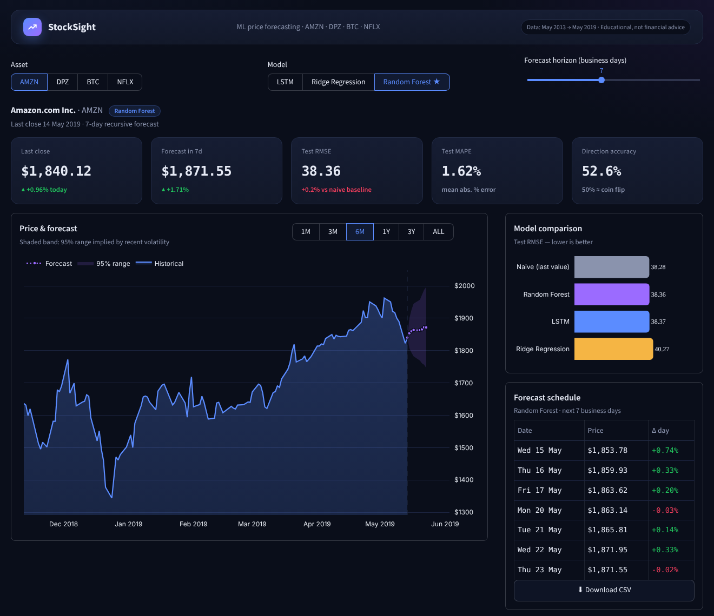
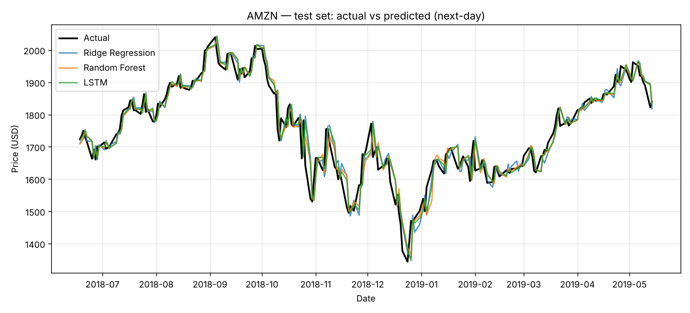

#  Stock Market Prediction with Machine Learning

Predicting next-day prices for **Amazon (AMZN)**, **Domino's Pizza (DPZ)**, **Bitcoin (BTC)** and **Netflix (NFLX)** with an LSTM neural network and classical ML baselines, served through an interactive **Streamlit** dashboard.

>  Educational project. Nothing here is financial advice.



---

##  Features

- **4 models compared fairly** on the same data: Naive baseline, Ridge Regression, Random Forest and a 2-layer **LSTM** (TensorFlow/Keras).
- **Leak-free evaluation**: chronological train / validation / test split (no shuffling of time series).
- **Scale-free features**: each 60-day window is normalised by its last price and the model predicts the next-day **% change**, so it still works when prices move outside the training range.
- **Metrics in real dollars**: RMSE, MAE, MAPE and **directional accuracy** (did the model get up/down right?).
- **Recursive N-day forecasting** (1–30 business days) from the CLI or the dashboard.
- **Professional dark dashboard (Streamlit)**: KPI cards, interactive price chart with forecast and 95 % volatility band, range selector (1M → ALL), model comparison, interactive backtest, CSV export.
- Pre-trained models included — the app runs right after install.

---

##  Project structure

```
stock-market-prediction/
├── data/
│   └── stock_data.csv          # Daily closes, May 2013 – May 2019 (1,520 rows)
├── src/
│   ├── config.py               # Paths & hyper-parameters
│   ├── data_loader.py          # Load / clean CSV, chronological split
│   ├── features.py             # 60-day sliding windows, % change targets
│   ├── models.py               # LSTM, baselines, recursive forecast, metrics
│   ├── train.py                # Train + evaluate + save everything
│   └── predict.py              # Forecast the next N business days
├── models/                     # Trained models (*.keras, *.joblib)
├── reports/
│   ├── metrics_summary.csv     # Test metrics for every ticker × model
│   ├── metrics_<TICKER>.json   # Detailed val/test metrics + best model
│   ├── backtest_<TICKER>.csv   # Test-set predictions for the dashboard
│   └── figures/                # Dashboard screenshot, prediction plots, LSTM loss curves
├── app.py                      # Streamlit dashboard (custom dark UI)
├── .streamlit/config.toml      # Dashboard theme
├── requirements.txt
└── README.md
```

---

##  Quick start

```bash
# 1. Create a virtual environment (Python 3.10+)
python -m venv venv
venv\Scripts\activate          # Windows
# source venv/bin/activate     # macOS / Linux

# 2. Install dependencies
pip install -r requirements.txt

# 3. Launch the dashboard (uses the pre-trained models)
streamlit run app.py
```

Runs fine on **CPU only** — no GPU needed.

### Retrain the models

```bash
python -m src.train                  # all tickers, all models (~2–4 min on CPU)
python -m src.train --ticker AMZN    # one ticker
python -m src.train --no-lstm        # skip TensorFlow, very fast
```

### Forecast from the command line

```bash
python -m src.predict --ticker AMZN --days 7            # uses best model on validation
python -m src.predict --ticker BTC --days 14 --model lstm
```

Options for `--model`: `lstm`, `ridge`, `rf`. Output is printed and saved to `reports/forecast_<TICKER>.csv`.

---

##  Methodology

| Step | Choice | Why |
|---|---|---|
| Split | 70 % train · 15 % val · 15 % test, **in time order** | Random shuffling leaks the future into training |
| Input | Last **60 days** of prices, as % distance from the last price | Scale-free; works at any price level |
| Target | Next-day **% change** → converted back to a price | Tree models and LSTMs can't extrapolate raw prices |
| Model selection | Lowest **validation** RMSE | The test set is only used for the final report |
| Forecast | Recursive: each prediction is appended to the window | Simple multi-step strategy (errors compound) |

**Splits:** train 2013-05 → 2017-07 · validation 2017-07 → 2018-06 · test 2018-06 → 2019-05.

**LSTM architecture** (adapted from the reference repo):
`LSTM(50, return_sequences) → Dropout(0.2) → LSTM(50) → Dropout(0.2) → Dense(25, relu) → Dense(1)`, Adam, MSE loss, early stopping on validation loss (patience 5, max 30 epochs).

---

##  Results (test set, Jun 2018 – May 2019)

| Ticker | Model | RMSE ($) | MAPE | Direction acc. |
|---|---|---:|---:|---:|
| AMZN | Naive (last value) | **38.28** | 1.59 % | — |
| AMZN | Ridge | 40.27 | 1.73 % | 47.4 % |
| AMZN | Random Forest ⭐ | 38.36 | 1.62 % | 52.6 % |
| AMZN | LSTM | 38.37 | **1.59 %** | **54.4 %** |
| DPZ | Naive ⭐ | **5.06** | **1.47 %** | — |
| DPZ | LSTM | 5.09 | 1.48 % | 50.0 % |
| BTC | Naive | **222.76** | **2.57 %** | — |
| BTC | LSTM ⭐ | 224.76 | 2.66 % | 49.6 % |
| NFLX | Naive | **9.32** | **2.13 %** | — |
| NFLX | LSTM ⭐ | 9.38 | 2.15 % | 47.4 % |

⭐ = best on validation. Full table in `reports/metrics_summary.csv`.



###  What the results mean

- **The LSTM and Random Forest are the strongest learned models, but no model beats the naive "tomorrow = today" baseline.** Directional accuracy hovers around 50 %, i.e. close to a coin flip.
- LSTM numbers can shift slightly between training runs on CPU; the conclusion does not change.
- This is the **expected, honest outcome** for daily prices using only past prices: markets are close to a random walk, so most of the "accuracy" in the chart above comes from tomorrow being near today. Projects that report 95 %+ accuracy on stock prices usually suffer from data leakage (shuffled splits, scaler fit on the whole dataset) or compare against no baseline.
- A first version of this project predicted raw scaled prices, like the reference repo. Random Forest then had a 42 % MAPE on AMZN and the LSTM 18 %, because test prices were higher than anything seen in training. Switching to % change targets fixed this — a good illustration of why feature design matters more than model choice.

---

##  Possible improvements

- Add features: volume, technical indicators (RSI, MACD, moving averages), cross-asset returns, news sentiment.
- Direct multi-step forecasting (one model per horizon) instead of recursive.
- Walk-forward (rolling) cross-validation for more robust metrics.
- Try GRU, Temporal Convolutional Networks or Transformers; probabilistic forecasts with prediction intervals.
- Pull fresh data with `yfinance` instead of a static CSV.

---

##  Tech stack

Python · pandas · NumPy · scikit-learn · TensorFlow/Keras · Streamlit · Plotly · Matplotlib

---

##  Credits

- Dataset and the original LSTM architecture/forecasting idea come from [AbhishekRDJ/Stock-Price-Prediction-Using-Machine-Learning](https://github.com/AbhishekRDJ/Stock-Price-Prediction-Using-Machine-Learning).
- This project rewrites the pipeline with leak-free splits, scale-free targets, baselines, model comparison and a reworked dashboard.

**Author:** Sirine — [github.com/Sirine008](https://github.com/Sirine008)
